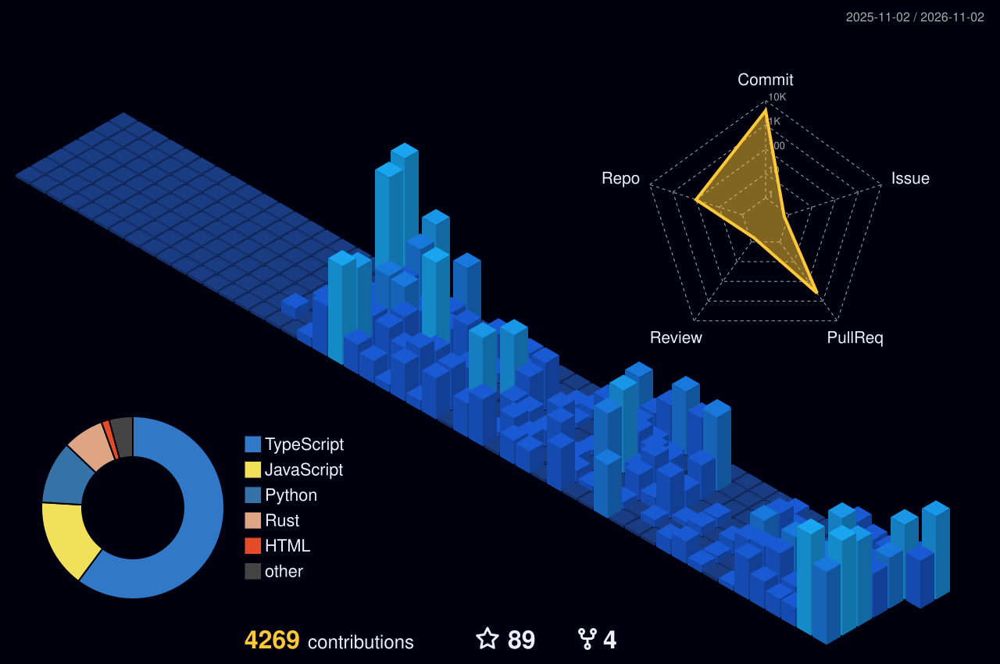

<div align="center">

<!-- HEADER -->
<!-- HERO: self-hosted animated SVG, generated by scripts/build_hero.py -->
<picture>
  <source media="(prefers-color-scheme: dark)" srcset="./assets/hero-dark.svg" />
  <source media="(prefers-color-scheme: light)" srcset="./assets/hero-light.svg" />
  
</picture>

<br/>

<!-- SOCIAL BADGES -->
<a href="https://github.com/knarayanareddy?tab=followers">
  
</a>


<br/><br/>

<a href="https://github.com/knarayanareddy?tab=repositories"></a>
<a href="https://github.com/knarayanareddy?tab=repositories&q=&type=source"></a>
<a href="https://www.linkedin.com/in/knarayanareddy/"></a>
<a href="https://github.com/knarayanareddy.atom"></a>

<!-- Add your own links here when you want them public, e.g.
<a href="mailto:you@example.com"></a>
-->

</div>

<br/>

<!-- ABOUT ME -->
## About Me

```python
class KiranNarayanareddy:
    def __init__(self):
        self.location = "Amsterdam, Netherlands"
        self.role = "Builder of autonomous, auditable agent systems"
        self.focus = [
            "Agent harnesses with hard safety boundaries",
            "Aerospace & physical-AI research pipelines",
            "Compliance-as-code for EU regulated products",
        ]
        self.method = "Six-week wonder → working prototype → evidence, or none of it ships"

    @property
    def skills(self):
        return {
            "languages": ["TypeScript", "Python", "JavaScript", "Rust", "Go", "Kotlin"],
            "agents": ["Claude Code", "Codex", "MCP", "multi-agent orchestration", "sandboxed execution"],
            "infra": ["GitHub Actions", "GitHub Pages", "Docker", "AWS CDK", "Serverless"],
            "domains": ["aerospace", "EU AI Act / GPSR / DSA", "fintech", "accessibility", "robotics"],
        }

    @property
    def ship_rate(self):
        return "A new public repository nearly every day, most with a live Pages build"
```

> I build in public and I publish the caveats. Most of what follows is a prototype with a
> working slice — each repo's README states exactly what is real, what is mocked, and what
> is not implemented yet. That honesty is the point of the whole portfolio.

---

<!-- AUTO COUNTERS -->
<div align="center">

<!-- COUNTERS:START -->
**33 live GitHub Pages sites** · **35 live deployments** · **124 original repositories** · **69 stars earned**

<sub>**TypeScript** 43 · **Python** 31 · **JavaScript** 11 · **HTML** 6 · **Rust** 4 · **Go** 2</sub>
<!-- COUNTERS:END -->

</div>

---

<!-- LIVE SITES -->
<div align="center">

## 🌐 Live Sites

**Everything below is deployed and running on GitHub Pages (or its own host), straight from CI.**

</div>

<!-- LIVE_SITES:START -->
| | Live site | Stack | What it does |
|:--:|-----------|-------|--------------|
| 🌐 | [**Aeroscribe**](https://knarayanareddy.github.io/Aeroscribe/) · [source](https://github.com/knarayanareddy/Aeroscribe) |   | Nine gated stages from literature archaeology to a submission-ready manuscript, every claim traceable to a recorded computation |
| 🌐 | [**toolscour**](https://knarayanareddy.github.io/toolscour/) · [source](https://github.com/knarayanareddy/toolscour) |   | 3D knowledge galaxy and stack architect over 11,000+ open-source AI tools, models, runtimes and skill packs |
| 🌐 | [**AI-Arsenal**](https://knarayanareddy.github.io/AI-Arsenal/) · [source](https://github.com/knarayanareddy/AI-Arsenal) |   | Schema-first, Markdown-native encyclopedia of AI engineering — readable by humans, LLMs and agents |
| 🌐 | [**AI-Daily**](https://knarayanareddy.github.io/AI-Daily/) · [source](https://github.com/knarayanareddy/AI-Daily) |   | A calm, curated daily briefing for the AI ecosystem, built on a Scout → Challenge → Agree editorial model |
| 🌐 | [**gitscour**](https://knarayanareddy.github.io/gitscour/) · [source](https://github.com/knarayanareddy/gitscour) |   | Queryable knowledge base of 50,000+ high-star GitHub repositories, sharded and served free from Pages |
| 🌐 | [**Aerorepos**](https://knarayanareddy.github.io/Aerorepos/) · [source](https://github.com/knarayanareddy/Aerorepos) |   | Curated directory of open-source aerospace engineering projects — aero, propulsion, structures, GNC, space |
| 🌐 | [**WebsitedesignandPrompts**](https://knarayanareddy.github.io/WebsitedesignandPrompts/) · [source](https://github.com/knarayanareddy/WebsitedesignandPrompts) |   | Democratising the paywalled web: reusable landing-page templates with the full build prompts |
| 🌐 | [**Bunqsy**](https://knarayanareddy.github.io/Bunqsy/) · [source](https://github.com/knarayanareddy/Bunqsy) |   | Always-on financial guardian: 7-agent risk oracle, proactive interventions, nightly Dream Mode |
<!-- LIVE_SITES:END -->

<br/>

<details>
<summary><b>📚 The rest of the live catalogue — every deployed site</b></summary>
<br/>

<!-- SITE_CATALOGUE:START -->
<table>
<tr>
<td width="50%" valign="top">

| Live site | Stack |
|-----------|-------|
| [**3dexperimentation**](https://knarayanareddy.github.io/3dexperimentation/) |  |
| [**gridqueue-grid-connection**](https://knarayanareddy.github.io/gridqueue-grid-connection/) |  |
| [**twitch-codex**](https://knarayanareddy.github.io/twitch-codex/) |  |
| [**redflag-eu-compliance**](https://knarayanareddy.github.io/redflag-eu-compliance/) |  |
| [**jointcheck-solder-inspection**](https://knarayanareddy.github.io/jointcheck-solder-inspection/) |  |
| [**reflex-physical-ai**](https://knarayanareddy.github.io/reflex-physical-ai/) |  |
| [**curiolab**](https://knarayanareddy.github.io/curiolab/) |  |
| [**nexttime**](https://knarayanareddy.github.io/nexttime/) |  |
| [**roomsmith**](https://knarayanareddy.github.io/roomsmith/) |  |
| [**accesshold**](https://knarayanareddy.github.io/accesshold/) |  |
| [**harvestgrid**](https://knarayanareddy.github.io/harvestgrid/) |  |
| [**Agentcrash**](https://knarayanareddy.github.io/Agentcrash/) |  |
| [**Nimbus**](https://knarayanareddy.github.io/Nimbus/) |  |
| [**SAAF-circuit-breaker**](https://knarayanareddy.github.io/SAAF-circuit-breaker/) |  |

</td>
<td width="50%" valign="top">

| Live site | Stack |
|-----------|-------|
| [**so101-domain-operator**](https://knarayanareddy.github.io/so101-domain-operator/) |  |
| [**Handy**](https://knarayanareddy.github.io/Handy/) |  |
| [**Courserefresh**](https://knarayanareddy.github.io/Courserefresh/) |  |
| [**LEGACYVAULTV1.0**](https://knarayanareddy.github.io/LEGACYVAULTV1.0/) |  |
| [**Autoorg**](https://knarayanareddy.github.io/Autoorg/) |  |
| [**idea-dump**](https://knarayanareddy.github.io/idea-dump/) |  |
| [**Magpie**](https://knarayanareddy.github.io/Magpie/) |  |
| [**ghosthandshake**](https://knarayanareddy.github.io/ghosthandshake/) |  |
| [**keepsake**](https://knarayanareddy.github.io/keepsake/) |  |
| [**proofpress-evidence-portal**](https://knarayanareddy.github.io/proofpress-evidence-portal/) |  |
| [**dreamswarm**](https://knarayanareddy.github.io/dreamswarm/) |  |
| [**F1Elastichopsworkshack**](https://f1hackdemo.kiranreddy.nl/) ↗ |  |
| [**vouwfiets**](https://vouwfiets.vercel.app/) ↗ |  |

</td>
</tr>
</table>
<!-- SITE_CATALOGUE:END -->

</details>

---

<!-- RECENT WORK -->
<div align="center">

## 🚀 Recently Shipped

</div>

<!-- SHIPPED:START -->
- 🚀 **[`Aeroscribe`](https://github.com/knarayanareddy/Aeroscribe)** — [live](https://knarayanareddy.github.io/Aeroscribe/) · pushed 2026-11-01
- 🛰️ **[`toolscour`](https://github.com/knarayanareddy/toolscour)** — [live](https://knarayanareddy.github.io/toolscour/) · pushed 2026-11-01
- 🧠 **[`AI-Daily`](https://github.com/knarayanareddy/AI-Daily)** — [live](https://knarayanareddy.github.io/AI-Daily/) · pushed 2026-11-01
- 🧪 **[`AI-Arsenal`](https://github.com/knarayanareddy/AI-Arsenal)** — [live](https://knarayanareddy.github.io/AI-Arsenal/) · pushed 2026-11-01
- 🔭 **[`3dexperimentation`](https://github.com/knarayanareddy/3dexperimentation)** — [live](https://knarayanareddy.github.io/3dexperimentation/) · pushed 2026-10-29
- ⚙️ **[`Aerorepos`](https://github.com/knarayanareddy/Aerorepos)** — [live](https://knarayanareddy.github.io/Aerorepos/) · pushed 2026-10-29
- 🛡️ **[`gridqueue-grid-connection`](https://github.com/knarayanareddy/gridqueue-grid-connection)** — [live](https://knarayanareddy.github.io/gridqueue-grid-connection/) · pushed 2026-10-29
- 🎛️ **[`twitch-codex`](https://github.com/knarayanareddy/twitch-codex)** — [live](https://knarayanareddy.github.io/twitch-codex/) · pushed 2026-10-29
<!-- SHIPPED:END -->

---

## What I'm Building

<div align="center">

| | Track | The idea | Flagships |
|:--:|-------|----------|-----------|
| 🛰️ | **Agent harnesses** | Frontier models are only as good as the cage around them: confinement rings, isolation, durable state, review loops | [**apex**](https://github.com/knarayanareddy/apex) · [**Harness-Zero**](https://github.com/knarayanareddy/Harness-Zero) · [**Autoorg**](https://knarayanareddy.github.io/Autoorg/) |
| 🚀 | **Aerospace research** | An autonomous research lab where every quantitative claim traces back to a recorded computation | [**Aeroscribe**](https://knarayanareddy.github.io/Aeroscribe/) · [**Aerorepos**](https://knarayanareddy.github.io/Aerorepos/) |
| 🛡️ | **Compliance-as-code** | Regulation as an executable gate, not a PDF: EU AI Act, GPSR, DSA evidence packs | [**exhibit**](https://github.com/knarayanareddy/exhibit) · [**redflag-eu-compliance**](https://github.com/knarayanareddy/redflag-eu-compliance) · [**listguard**](https://github.com/knarayanareddy/listguard) · [**clausewindow**](https://github.com/knarayanareddy/clausewindow) |
| 🦾 | **Physical AI** | Safety envelopes, verification ledgers and domain-scoped operators for robots that touch the real world | [**reflex-physical-ai**](https://github.com/knarayanareddy/reflex-physical-ai) · [**so101-domain-operator**](https://knarayanareddy.github.io/so101-domain-operator/) · [**jointcheck**](https://github.com/knarayanareddy/jointcheck-solder-inspection) |
| 💸 | **Agentic finance** | Agents that act before damage is done, with a gate between proposal and execution | [**Bunqsy**](https://knarayanareddy.github.io/Bunqsy/) · [**Guardian**](https://github.com/knarayanareddy/Guardian) · [**LEGACYVAULTV1.0**](https://knarayanareddy.github.io/LEGACYVAULTV1.0/) |
| ♿ | **Accessibility** | Interfaces that adapt to the person instead of asking the person to adapt | [**clarion**](https://github.com/knarayanareddy/clarion) · [**accesshold**](https://knarayanareddy.github.io/accesshold/) · [**LitPlay**](https://github.com/knarayanareddy/LitPlay) |

</div>

---

## Hackathons & Sprints

<div align="center">

> Built under a clock, shipped to a live demo, documented afterwards.

| Event | What shipped |
|-------|--------------|
| bunq Hackathon 7.0 | [**BUNQSY**](https://knarayanareddy.github.io/Bunqsy/) — always-on financial guardian with a 7-agent risk oracle |
| Vultr Cloud Hackathon | [**SENTINEL**](https://github.com/knarayanareddy/Sentinel) — fail-closed financial oversight agent behind a 3-signal gate |
| Slack Agent Builder Challenge | [**Clarion**](https://github.com/knarayanareddy/clarion) — accessibility agent, live-tested in a real Slack sandbox |
| Prosus Build Weekend | [**Magpie**](https://github.com/knarayanareddy/Magpie) — autonomous classifieds scout that haggles and closes |
| TechEx Amsterdam | [**Agentcrash**](https://knarayanareddy.github.io/Agentcrash/) — SAAF policy circuit breaker for support agents |
| TwitchCon Codex Hackathon | [**twitch-codex**](https://github.com/knarayanareddy/twitch-codex) — four live-audience, control and accessibility builds |
| OneGov / Alkemio | [**onegov2-spatial-assistant**](https://github.com/knarayanareddy/onegov2-spatial-assistant) — Dutch spatial-assistant challenge entry |
| F1 × Elastic × Hopsworks | [**F1Elastichopsworkshack**](https://f1hackdemo.kiranreddy.nl/) — explorable 2023–24 race workspace |

</div>

---

## Collections & Explorers

<div align="center">

| | Project | Why it exists |
|:--:|---------|---------------|
| 🛰️ | [**toolscour**](https://knarayanareddy.github.io/toolscour/) | 11,000+ AI tools mapped as a 3D galaxy, with a stack architect that scores compatibility |
| 🔭 | [**gitscour**](https://knarayanareddy.github.io/gitscour/) | The same sharding pipeline applied to 50,000+ high-star repos |
| 🧰 | [**AI-Arsenal**](https://knarayanareddy.github.io/AI-Arsenal/) | A machine-readable encyclopedia an agent can consume as easily as a human |
| 📰 | [**AI-Daily**](https://knarayanareddy.github.io/AI-Daily/) | Scout → Challenge → Agree, so the news you read was argued with first |
| 🎨 | [**WebsitedesignandPrompts**](https://knarayanareddy.github.io/WebsitedesignandPrompts/) | The paywalled web, rebuilt as reusable templates plus the prompts that make them |
| 🧪 | [**3dexperimentation**](https://knarayanareddy.github.io/3dexperimentation/) | Pure-code animated film studio — Canvas, no assets, 60 FPS |

</div>

---

## Tech Stack

<div align="center">

### Languages


### AI & Agents


### Web, Data & Infra


### Domain


</div>

---

## GitHub Stats

<div align="center">


</div>

<details>
<summary><b>More stats</b></summary>
<div align="center">


</div>
</details>

<details>
<summary><b>🐍 Contribution snake</b></summary>
<div align="center">

<picture>
  <source media="(prefers-color-scheme: dark)" srcset="https://raw.githubusercontent.com/knarayanareddy/Kiran-Narayanareddy/output/snake-dark.svg" />
  <source media="(prefers-color-scheme: light)" srcset="https://raw.githubusercontent.com/knarayanareddy/Kiran-Narayanareddy/output/snake.svg" />
  
</picture>

<sub>Generated daily by <a href=".github/workflows/snake.yml">snake.yml</a> into the <code>output</code> branch.</sub>

</div>
</details>

<details>
<summary><b>🏔️ 3D contribution terrain</b></summary>
<div align="center">

<picture>
  <source media="(prefers-color-scheme: dark)" srcset="./profile-3d-contrib/profile-night-view.svg" />
  <source media="(prefers-color-scheme: light)" srcset="./profile-3d-contrib/profile-season-animate.svg" />
  
</picture>

<sub>Isometric render of the last year of commits by <a href=".github/workflows/3d-contrib.yml">3d-contrib.yml</a>.</sub>

</div>
</details>

<details>
<summary><b>Contribution activity</b></summary>
<div align="center">


</div>
</details>

---

<!-- FOOTER -->
<div align="center">


**Amsterdam, Netherlands** · Autonomous agents · Aerospace & physical AI · Compliance-as-code

<sub>Live sites and counters are refreshed by <a href=".github/workflows/update-profile.yml">GitHub Actions</a> — see <a href="scripts/build_profile.py">scripts/build_profile.py</a></sub>

</div>

<!-- Last updated: 2026-11-02 07:47 UTC -->
